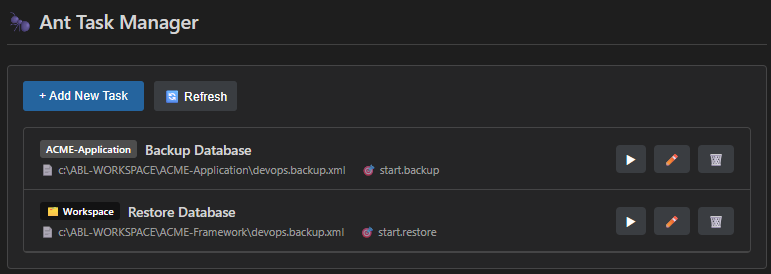
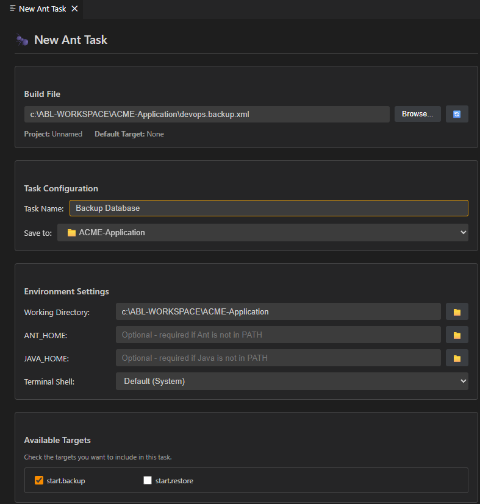
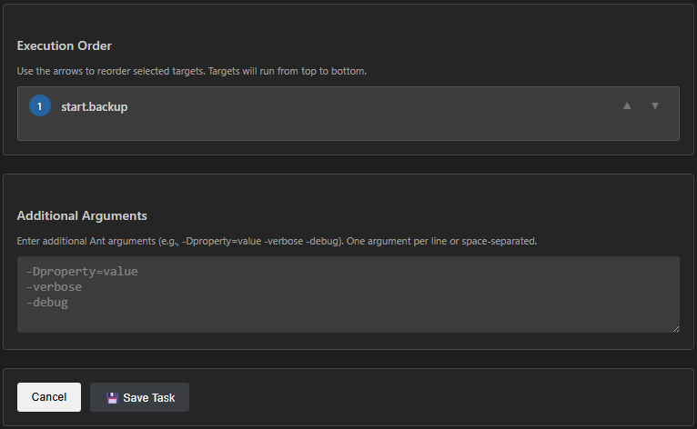
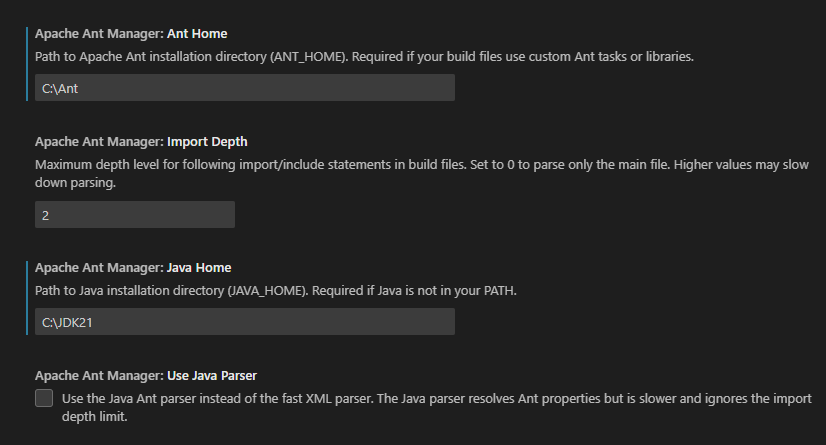

# Task Manager (formerly Apache Ant Manager)

[](https://marketplace.visualstudio.com/items?itemName=diabolo-68.apache-ant-manager)
[](https://opensource.org/licenses/MIT)

A Visual Studio Code extension that provides a graphical UI for configuring and running tasks: Apache Ant builds (similar to Eclipse's Ant launcher), shell, batch, PowerShell, Python and Node.js scripts, and any custom command. Everything is saved as standard VS Code tasks in `tasks.json`.

## Features

-  **Task Manager view** - A "Task Manager" section in the Explorer lists your tasks (grouped by workspace folder), with inline run / edit, and duplicate / delete in the context menu
-  **Ant builds** - Parse a build file, pick targets (filterable, with descriptions and dependencies) and order them with drag-and-drop or Alt+↑/↓
-  **Script tasks** - Shell (bash, sh, zsh), Batch (.bat/.cmd), PowerShell (.ps1), Python (.py, detects virtual environments) and Node.js scripts
-  **Custom commands** - Run any program (make, gradle, docker, …), optionally through the shell
-  **Live command preview** - See the exact command line before saving
-  **Environment** - Working directory, environment variables, ANT_HOME / JAVA_HOME, terminal behaviour and task group
-  **Save & Run** - Save a task and run it in one step (Ctrl+Enter); Ctrl+S saves
-  **Re-run last task** - From the status bar
-  **Multi-Root Workspace Support** - Save tasks to any workspace folder or to the shared workspace file, and move them between locations

## Screenshots

### Task Manager View


### Task Configuration



### Extension Settings


## Installation

### From VS Code Marketplace

1. Open VS Code
2. Go to Extensions (Ctrl+Shift+X)
3. Search for "Task Manager" (publisher diabolo-68)
4. Click **Install**

### From Source

```bash
git clone https://github.com/diabolo-68/apache-ant-manager.git
cd apache-ant-manager
npm install
npm run compile
```

Then press F5 in VS Code to launch the extension in debug mode.

## Usage

### Creating a task

1. **From the Explorer**: click **+** in the *Task Manager* view, then choose the kind of task (Ant build, shell / batch / PowerShell / Python / Node.js script, or custom command) and the file
2. **From a file**: right-click an Ant build file or a script (`.xml`, `.sh`, `.bat`, `.cmd`, `.ps1`, `.py`, `.js`) and select **Create Task from This File**
3. **From the Command Palette**: run **Task Manager: New Task…**

### Configuring an Ant task

1. Enter a name for your task and choose where to save it (workspace folder or shared workspace file)
2. Tick the targets to run; selected targets move to the *Run order* group, where you can drag them (or use Alt+↑/↓) to reorder
3. Add properties (`-Dname=value`), common options (`-verbose`, `-debug`, …) or other arguments
4. Optionally expand **Environment** to set the working directory, ANT_HOME, JAVA_HOME or the terminal shell
5. Check the **Command preview**, then **Save Task** (Ctrl+S) or **Save & Run** (Ctrl+Enter)

### Configuring a script or command task

1. Pick the script (or, for a custom command, the program) and enter arguments, one per line
2. Adjust the interpreter if needed — suggestions include virtual environments found in the workspace for Python
3. Optionally set the working directory, environment variables, terminal behaviour and task group (Build / Test)

Script tasks are stored as regular `process` tasks (batch files and shell-mode custom commands as `shell` tasks), so they also appear in VS Code's **Run Task** list. A `taskManager` block in each entry lets the editor reopen it with the same settings.

### Managing tasks

- **Run**: click ▶ next to a task in the Task Manager view, use **Task Manager: Run Task…**, VS Code's built-in **Run Task**, or the re-run button in the status bar
- **Run a single Ant target**: expand an Ant task in the tree and click ▶ next to a target
- **Edit / Duplicate / Delete**: from the tree's inline buttons and context menu, or from the full-page list (**Task Manager: Open Task Manager**)

### Multi-Root Workspace Support

When working with multi-root workspaces:
- Tasks are grouped by the folder they belong to
- You can save tasks to any workspace folder or to the shared workspace file
- Moving tasks between folders is supported when editing

## Requirements

- **Visual Studio Code** 1.85.0 or higher
- **Apache Ant** (for Ant tasks) - Should be installed and accessible via PATH, or configured via ANT_HOME
- The interpreter for your scripts (bash, PowerShell, Python, Node.js, …) on PATH, or configured per task

### Optional

- **Java Runtime Environment (JRE) 11+** - Required only if using the Java parser option for advanced Ant property resolution

## Extension Settings

This extension contributes the following settings:

| Setting | Default | Description |
|---------|---------|-------------|
| `apacheAntManager.antHome` | `""` | Path to Apache Ant installation directory (ANT_HOME). Required if your build files use custom Ant tasks or libraries. |
| `apacheAntManager.javaHome` | `""` | Path to Java installation directory (JAVA_HOME). Required if Java is not in your PATH. |
| `apacheAntManager.importDepth` | `2` | Maximum depth level for following import/include statements in build files. Set to 0 to parse only the main file. |
| `apacheAntManager.useJavaParser` | `false` | Use the Java Ant parser instead of the fast XML parser. The Java parser resolves Ant properties but is slower. |

## Commands

| Command | Description |
|---------|-------------|
| `Task Manager: New Task…` | Create an Ant, script or command task |
| `Task Manager: Run Task…` | Pick a managed task and run it |
| `Task Manager: Re-run Last Task` | Run the most recently run task again |
| `Task Manager: Edit Task…` / `Duplicate Task…` / `Delete Task…` | Manage existing tasks |
| `Task Manager: Open Task Manager` | Open the full-page task list |
| `Task Manager: Refresh` | Reload tasks from `tasks.json` |

## Building from Source

### Prerequisites

- Node.js 18+
- npm

### Optional (for Java parser)

- Java JDK 11+
- Maven 3.6+

### Build Steps

```bash
# Install dependencies
npm install

# Compile TypeScript
npm run compile

# (Optional) Build Java parser component
cd java
mvn package
cd ..

# Run in debug mode - Press F5 in VS Code
```

### Project Structure

```
apache-ant-manager/
├── src/                    # TypeScript extension source
│   ├── extension.ts        # Extension entry point
│   ├── panels/             # Webview panels
│   ├── providers/          # Tree view providers
│   ├── services/           # Business logic services
│   └── types/              # TypeScript type definitions
├── java/                   # Java Ant parser component (optional)
│   ├── pom.xml
│   └── src/main/java/
├── media/                  # Webview CSS and assets
└── .vscode/                # VS Code configuration
```

## Known Issues

- The Java parser option requires Java 11+ and may be slower for large build files with many imports
- Target descriptions are only shown if defined in the build file's `description` attribute

## Contributing

Contributions are welcome! Please feel free to submit a Pull Request.

1. Fork the repository
2. Create your feature branch (`git checkout -b feature/AmazingFeature`)
3. Commit your changes (`git commit -m 'Add some AmazingFeature'`)
4. Push to the branch (`git push origin feature/AmazingFeature`)
5. Open a Pull Request

## Repository

- **GitHub**: [https://github.com/diabolo-68/apache-ant-manager](https://github.com/diabolo-68/apache-ant-manager)
- **Issues**: [https://github.com/diabolo-68/apache-ant-manager/issues](https://github.com/diabolo-68/apache-ant-manager/issues)

## License

This project is licensed under the MIT License - see the [LICENSE](LICENSE) file for details.

## Acknowledgments

- Inspired by Eclipse's Ant Build configuration dialog
- Uses the [Apache Ant](https://ant.apache.org/) build tool
- Built with the [VS Code Extension API](https://code.visualstudio.com/api)

---

**Enjoy building with Ant! 🐜**
