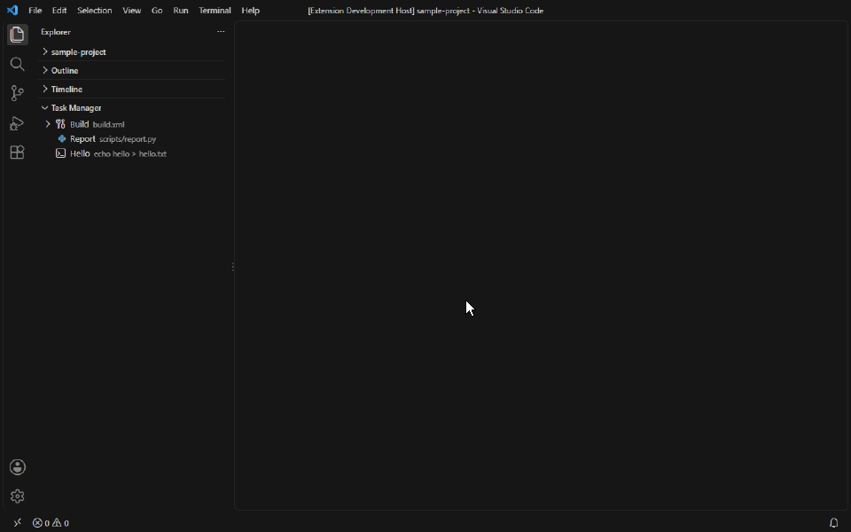
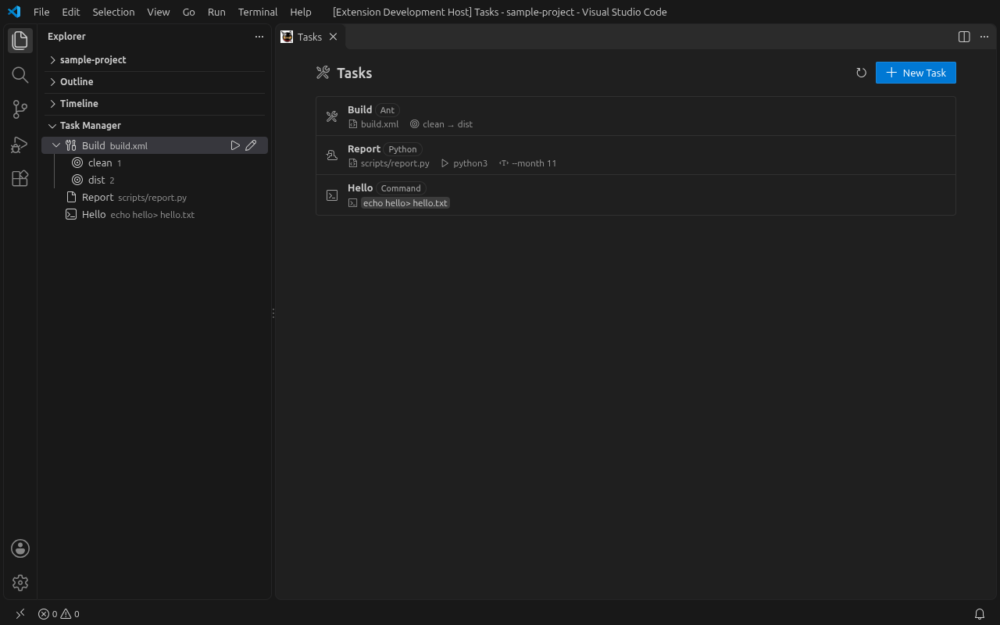
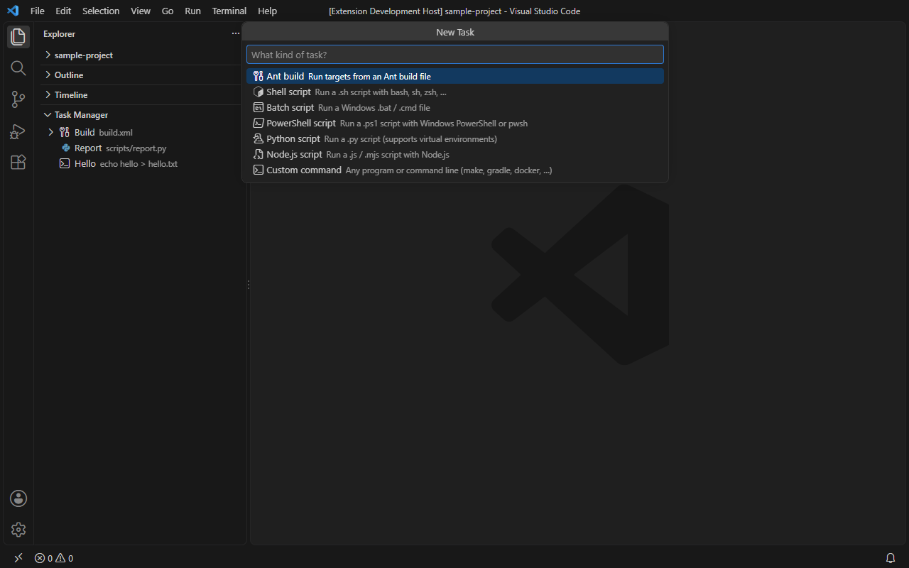
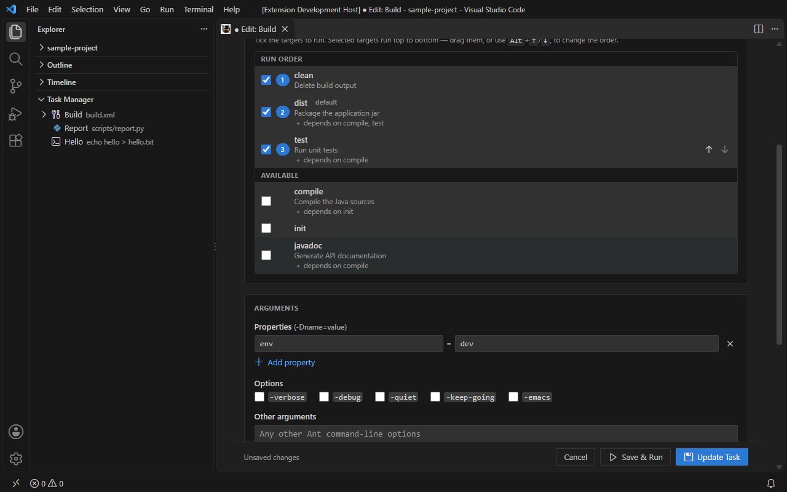
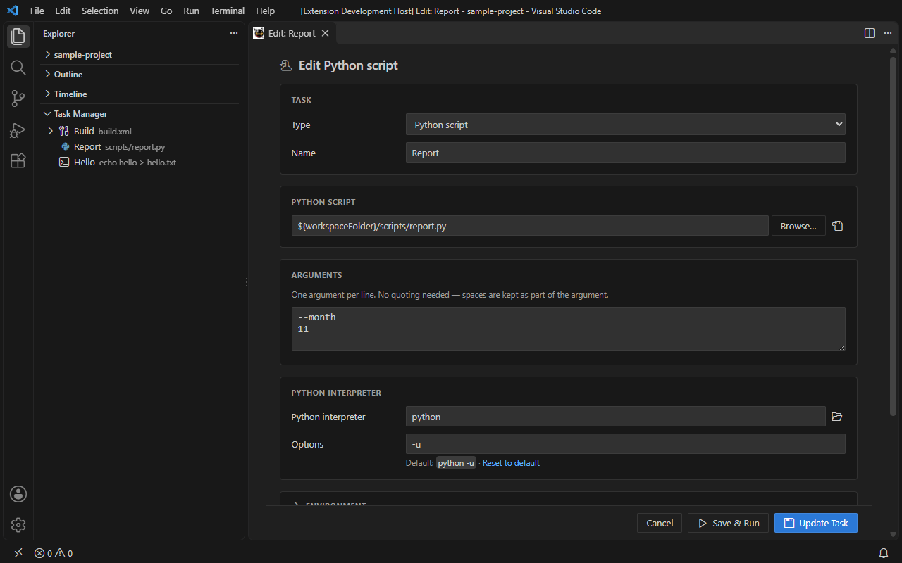
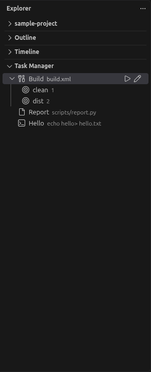

# Task Studio — Scripts, Commands & More

[](https://marketplace.visualstudio.com/items?itemName=diabolo-68.apache-ant-manager)
[](https://github.com/diabolo-68/apache-ant-manager/actions/workflows/ci.yml)
[](LICENSE)

Create, edit and run VS Code tasks with a form instead of hand-editing `tasks.json`. Task Studio handles:

- **Apache Ant builds**: pick and order targets, much like Eclipse's Ant launcher
- **Scripts**: shell (bash, sh, zsh), Batch, PowerShell, Python and Node.js
- **Any other command**: make, gradle, docker, npm…

Everything is saved as standard VS Code tasks, so your tasks also work with **Run Task**, keybindings and `dependsOn`, and on teammates' machines without the extension.

> Formerly **Apache Ant Manager**. The extension ID, commands and settings are unchanged, so existing installs and tasks keep working.



*Creating a PowerShell task on Windows: pick the kind and the script, name it, add an argument, then **Save & Run**. The task appears in the Task Studio view and runs in the terminal.*

## Features



- **Task Studio view in the Explorer.** All your tasks in one place, grouped by workspace folder. Run or edit them inline; duplicate and delete them from the context menu.
- **Ant targets.** The build file is parsed, including imports. Targets come with their descriptions and dependencies, and can be filtered and ordered by drag and drop or <kbd>Alt</kbd>+<kbd>↑</kbd>/<kbd>↓</kbd>. Expand an Ant task in the tree to run a single target.
- **Scripts.** Pick a script and enter its arguments one per line, with no quoting needed. The interpreter is suggested for you, including Python virtual environments in the workspace.
- **Custom commands.** Run any program directly, or through the shell for pipes and `&&`.
- **Live command preview.** See exactly what will run before you save.
- **Environment.** Set the working directory, environment variables and ANT_HOME / JAVA_HOME, choose the terminal behaviour, and add the task to the Build or Test group.
- **Save & Run** with <kbd>Ctrl</kbd>+<kbd>Enter</kbd>, **Save** with <kbd>Ctrl</kbd>+<kbd>S</kbd>, and **Re-run last task** from the status bar.
- **Multi-root workspaces.** Save a task in any folder or in the shared `.code-workspace` file, and move it between them.
- **Safe with your `tasks.json`.** Comments, formatting and tasks the extension doesn't manage are preserved. A file that can't be parsed is never overwritten.

## Getting started

*The screenshots show VS Code on Windows with the Default Dark Modern theme.*

1. Open the **Task Studio** section in the Explorer and click **+** (or run **Task Studio: New Task…**).
2. Choose what to run.

   

3. Pick the build file or script. Files of the right type found in the workspace are listed first.
4. Fill in the form, check the command preview, and click **Save Task** or **Save & Run**.

You can also right-click a build file or script in the Explorer (`.xml`, `.sh`, `.bat`, `.cmd`, `.ps1`, `.py`, `.js`) and select **Create Task from This File**.

### Ant tasks



- Tick targets to add them to the **Run order**, then drag them to reorder. The build file's default target is preselected.
- Add properties (`-Dname=value`) in the property table, tick common options (`-verbose`, `-debug`, `-quiet`, `-keep-going`, `-emacs`), or type any other arguments.
- Under **Environment**, set the working directory, ANT_HOME, JAVA_HOME and the shell. Values from the extension settings can be filled in with one click.

### Script and command tasks



| Kind | Default interpreter | Stored as |
|------|---------------------|-----------|
| Shell script | `bash` | `process` task |
| Batch script | `cmd.exe /d /c` | `shell` task run by `cmd.exe` |
| PowerShell script | `pwsh` (Linux/macOS), `powershell.exe` (Windows) | `process` task |
| Python script | `python3` (Linux/macOS), `python` (Windows) | `process` task |
| Node.js script | `node` | `process` task |
| Custom command | — | `process` task, or `shell` task when run through the shell |

When a task uses the default interpreter, it's saved with a `windows` override (for example `"command": "python3"` plus `"windows": { "command": "python" }`). The same `tasks.json` then works on Linux, macOS and Windows.

Each entry also stores a small `taskManager` block, which lets the editor reopen the task with exactly the same form values.

### Managing tasks



- **Run.** Click ▶ next to a task, use **Task Studio: Run Task…**, VS Code's **Run Task**, or the re-run button in the status bar.
- **Edit.** Click a script task, click the pencil icon on any task, or run **Task Studio: Edit Task…**.
- **Duplicate / Delete.** Use the context menu, or <kbd>Delete</kbd> in the view.
- **Full-page list.** Run **Task Studio: Open Task Studio**.

## Requirements

- VS Code 1.96 or later, on Windows, Linux or macOS.
- [Apache Ant](https://ant.apache.org/) for Ant tasks, on `PATH` or set via ANT_HOME.
- The interpreter for your scripts (bash, PowerShell, Python, Node.js…), on `PATH` or set per task.
- *Optional:* Java 11+ for the Java-based Ant parser (`apacheAntManager.useJavaParser`).

## Settings

| Setting | Default | Description |
|---------|---------|-------------|
| `apacheAntManager.antHome` | `""` | Apache Ant installation directory (ANT_HOME). Needed if your build files use custom Ant tasks or libraries. |
| `apacheAntManager.javaHome` | `""` | Java installation directory (JAVA_HOME). Needed if Java is not on your `PATH`. |
| `apacheAntManager.importDepth` | `2` | How many levels of `<import>` / `<include>` to follow when listing targets. `0` parses only the main file. |
| `apacheAntManager.useJavaParser` | `false` | Use the Java Ant parser, which resolves Ant properties but is slower, instead of the built-in XML parser. |

## Commands

| Command | Description |
|---------|-------------|
| **Task Studio: New Task…** | Create an Ant, script or command task |
| **Task Studio: Run Task…** | Pick a task and run it |
| **Task Studio: Re-run Last Task** | Run the most recently run task again |
| **Task Studio: Edit Task…** / **Duplicate Task…** / **Delete Task…** | Manage existing tasks |
| **Task Studio: Open Task Studio** | Open the full-page task list |
| **Task Studio: Refresh** | Reload tasks from `tasks.json` |

## Development

You need Node.js 20 or later. A JDK 11+ and Maven are needed only for the optional Java parser in `java/`. Everything works the same on Windows and Linux. The repository stores LF line endings everywhere except `.bat`/`.cmd` files (see `.gitattributes`).

```bash
npm install
npm run compile          # bundle the extension with webpack
# press F5 in VS Code to start an Extension Development Host
```

On Windows, `.\toolkit.ps1` opens an interactive menu to run the tests, view results, regenerate the screenshots, and package or publish the extension.

### Publishing

`publish.ps1` (or `node publish.js` on any OS) packages the extension and publishes that same `.vsix` to the VS Code Marketplace and OpenVSX. Tokens are read from the `VSCE_PAT` and `OVSX_PAT` environment variables. The Java parser jar must be built first (`mvn -f java/pom.xml package`) because it ships in the package.

```powershell
.\publish.ps1 -DryRun                            # package only
.\publish.ps1 [-SkipMarketplace] [-SkipOpenVSX] [-Force]
npm run publish:dry                              # same, via publish.js
npm run publish:all | publish:marketplace | publish:openvsx
```

### Tests

| Command | What it runs |
|---------|--------------|
| `npm run test:unit` | Mocha unit tests for the services, parser and tree view, in plain Node with a `vscode` stub. Fast, no VS Code needed. |
| `npm run test:integration` | Integration tests inside a real VS Code, downloaded to `.vscode-test/`, against a copy of `test-fixtures/workspace`. |
| `npm test` | Lint, then unit and integration tests |
| `npm run test:e2e` | [Playwright](https://playwright.dev/) end-to-end tests that drive the VS Code UI: the Explorer view, quick picks and the webview editors |
| `npm run screenshots` | Regenerates the images and the animated GIF in `docs/screenshots/` from the sample workspace |

On Linux without a display, prefix the VS Code-based suites with `xvfb-run -a`. The CI workflow runs all suites on Ubuntu, Windows and macOS.

#### Script tasks are run for real, on the OS you test on

The integration tests (`src/test/integration/scripts.test.ts`) and the e2e tests (`e2e/platform.spec.ts`) create a task of each script kind, run it, and check the file the fixture script writes. The integration tests save each task to `tasks.json` and also run it with **Save & Run**. The e2e tests create each task in the editor. The argument (`prod eu`) contains a space, and so does the script folder used by the integration tests (`my scripts/`), so quoting is tested too. A kind that can't run on the current OS is reported as skipped, with the reason:

| Kind | Windows | Linux / macOS |
|------|---------|---------------|
| Batch (`cmd.exe`) | ✅ | skipped |
| PowerShell | ✅ `powershell.exe` | ✅ if `pwsh` is installed |
| Shell (`bash`) | skipped | ✅ |
| Python | ✅ if `python` is on `PATH` | ✅ if `python3` is on `PATH` |
| Node.js | ✅ | ✅ |
| Custom command (default shell) | ✅ PowerShell | ✅ bash/sh |

#### Regenerating the README images

`npm run screenshots` drives VS Code through the sample workspace and writes the PNGs and `create-task.gif`. The GIF is encoded in plain Node (no ffmpeg). By default the workspace is copied to the system temp folder, whose path (including your user name) shows up in the GIF. Set `E2E_WORKSPACE_ROOT` to a neutral folder that doesn't exist yet; it is created and removed afterwards:

```powershell
$env:E2E_WORKSPACE_ROOT = 'C:\demo'; npm run screenshots
```

### Project structure

```
src/
├── extension.ts            # activation and command registration
├── taskActions.ts          # run / edit / duplicate / delete, status bar
├── panels/                 # webview editors (Ant, script) and the task list
├── services/               # tasks.json I/O, Ant parsing, script task conversion
├── views/                  # Explorer tree view
├── types/  util/
└── test/
    ├── unit/               # mocha + vscode stub
    └── integration/        # @vscode/test-cli
e2e/                        # Playwright tests, screenshot and GIF generator
test-fixtures/workspace/    # sample project used by the tests
java/                       # optional Java-based Ant parser
media/                      # webview CSS and codicons
```

## Contributing

Issues and pull requests are welcome at [github.com/diabolo-68/apache-ant-manager](https://github.com/diabolo-68/apache-ant-manager). Please run `npm test` and `npm run test:e2e` before opening a pull request.

## License

[MIT](LICENSE)
